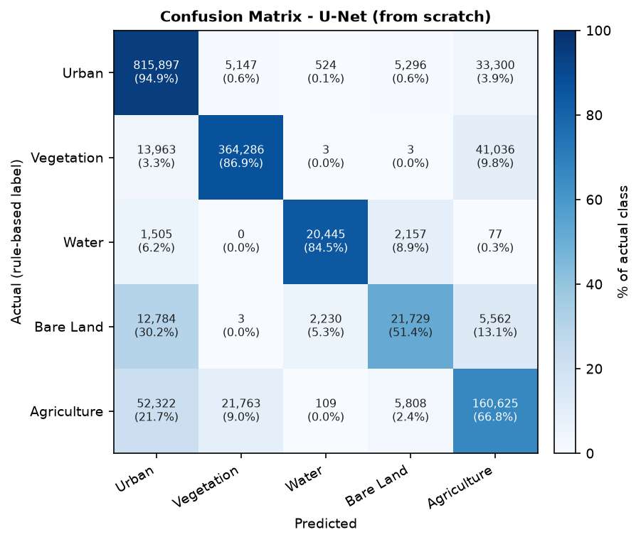
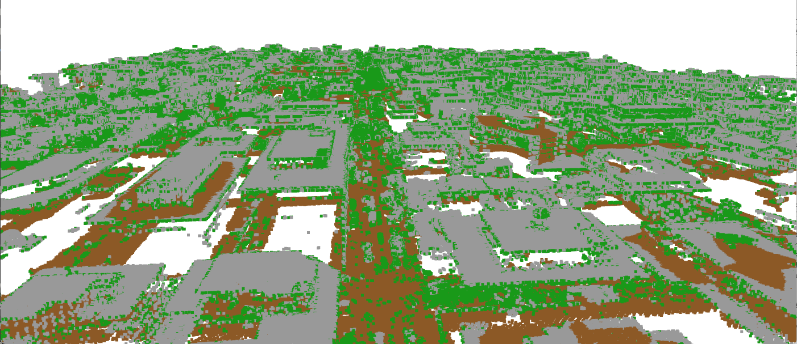
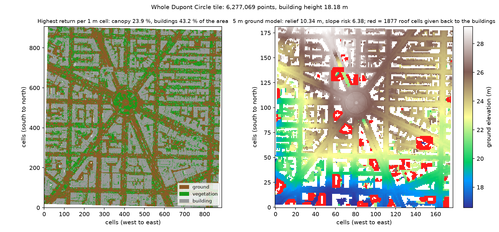
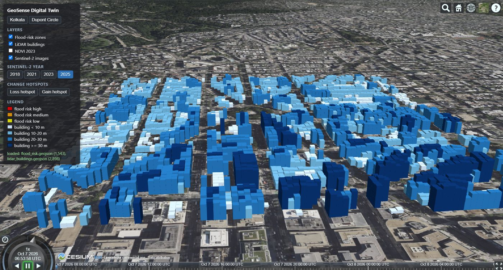
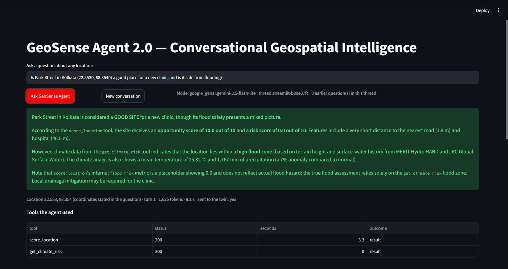

# GeoSense Agent 2.0

A geospatial site-intelligence system for **Kolkata, India**, built phase by phase:
machine learning on spatial features (Phase 1), deep learning on Sentinel-2 satellite imagery
(Phase 2), LiDAR point clouds and street-level imagery merged into one site profile (Phase 3), and an
MCP tool server, a LangGraph agent and a CesiumJS 3D digital twin with a Streamlit front end (Phase 4).

*Anubhav Ghosh · M.Tech Geoinformatics, Department of Geography, University of Madras*

| | |
|---|---|
| Study area | Kolkata bounding box 88.30–88.42 E, 22.45–22.67 N (≈ 12.6 × 24.5 km) |
| Metric CRS | EPSG:32645 (WGS 84 / UTM zone 45N) |
| Environment | conda `geosense`, Python 3.11, Windows 11, NVIDIA RTX 5060 Laptop GPU (8 GB); conda `geosense_lidar` for PDAL |
| LiDAR tile (Phase 3) | Dupont Circle, Washington, D.C. — 77.048–77.038 W, 38.905–38.913 N (0.8 km²), EPSG:32618 |

## Repository layout

```
src/phase1_ml/            Phase 1 — PostGIS ingestion, candidate grid, features, RF/XGBoost, site_scorer.py
src/phase2_dl/            Phase 2 — Sentinel-2 download, preprocessing, chips, labels, U-Net, Prithvi, evaluation, image_classifier.py
src/phase3_lidar/         Phase 3 — LiDAR fetch and PDAL pipeline, features, PLY, NAIP, SAM rooftops, SegFormer street scenes, lidar_analyzer.py, unified_site_profile.py
src/phase4_agent/         Phase 4 — MCP tool server (mcp_server.py + tools/), LangGraph agent, data-layer scripts, Streamlit app
frontend/digital_twin/    Phase 4 — CesiumJS digital twin built with Vite (node_modules, .env and the tile pyramids are not committed)
data/processed/           Phase 1 candidate grid, feature table and labelled dataset
data/satellite/clean/     Phase 2 composite metadata (the 400 MB of arrays are regenerated, not committed)
data/streetview/results/  Phase 3 frozen Mapillary query snapshots (the photographs themselves are not committed)
models/evaluation/        training histories, train/validation split, model comparison
outputs/reports/          Phase 1 label map and SHAP importance; Phase 3 site profiles and bounding-box results
outputs/plots/            Phase 2 confusion matrices, training curves, IoU comparison, prediction gallery
outputs/point_clouds/     Phase 3 point-cloud screenshots, grid-metric maps, lidar_analyzer figures (the PLY is regenerated)
outputs/rooftops/         Phase 3 SAM rooftop candidates with LiDAR heights and volumes
outputs/streetview/       Phase 3 scene compositions, location results, SegFormer examples
outputs/digital_twin/     Phase 4 twin and Streamlit screenshots used in this README
outputs/agent_examples/   Phase 4 example agent transcripts and the tool-selection measurement
docs/                     data inventory, Phase 2–4 checklists with evidence, glossary application, the Postman collection
tests/                    pytest unit tests (Phase 1 site scorer, Phase 3 modules, Phase 4 server and agent)
notebooks/                labelling notebook
```

Large artefacts are not committed: raw OSM/shapefile data, the Sentinel-2 composites, chips and
labels (`data/satellite/`, ≈ 400 MB), the trained weights (`models/saved/*.pth`, 98 MB and 353 MB), the
LiDAR tiles (`data/lidar/`, 36 + 63 MB), the street photographs, the SAM checkpoint (375 MB) and the
colour-coded PLY (170 MB), and from Phase 4 the Sentinel-2 tile pyramids and GeoTIFFs of the twin
(`frontend/digital_twin/public/imagery/`, `data/twin/`, 260 MB), the Earth Engine cache and the agent
transcripts (a few examples are kept in `outputs/agent_examples/`). The scripts below regenerate all of them.

## Setup

```bash
conda create -n geosense python=3.11 && conda activate geosense
pip install torch torchvision torchaudio --index-url https://download.pytorch.org/whl/cu128   # or the /cpu index
pip install -r requirements.txt
earthengine authenticate
# Phase 3: PDAL in its own environment (the two PDAL scripts), SAM weights for the rooftop script
conda create -n geosense_lidar --override-channels -c conda-forge python=3.11 pdal python-pdal -y
conda run -n geosense_lidar pip install python-dotenv
# download https://dl.fbaipublicfiles.com/segment_anything/sam_vit_b_01ec64.pth into models/saved/sam/
# Phase 4: the Python side is in requirements.txt; the digital twin needs Node.js 18+ (24 used here)
cd frontend/digital_twin && npm install && cd ../..
python src/phase4_agent/make_twin_env.py        # frontend/digital_twin/.env from CESIUM_ION_TOKEN
```

Create a `.env` in the project root (never committed):

```
DB_HOST=localhost  DB_PORT=5432  DB_NAME=geosense  DB_USER=postgres  DB_PASSWORD=...
STUDY_AREA=Kolkata
BBOX_MIN_LON=88.30  BBOX_MIN_LAT=22.45  BBOX_MAX_LON=88.42  BBOX_MAX_LAT=22.67
GEE_PROJECT=<your Google Cloud project id>
# Phase 3
MAPILLARY_TOKEN=MLY|...            OPENTOPOGRAPHY_API_KEY=...
SAM_CHECKPOINT_PATH=models/saved/sam/sam_vit_b_01ec64.pth
STUDY_AREA_BBOX_LIDAR=-77.048,38.905,-77.038,38.913
# Phase 4
GOOGLE_API_KEY=...                 # Gemini API key from Google AI Studio (free tier)
# ANTHROPIC_API_KEY=...            # optional: Claude, with AGENT_MODEL=anthropic:claude-sonnet-4-6
CESIUM_ION_TOKEN=...               # copied into frontend/digital_twin/.env by make_twin_env.py
MCP_SERVER_URL=http://localhost:8000
AGENT_MODEL=google_genai:gemini-3.5-flash-lite
```

## Phase 1 — Site suitability from spatial features

OpenStreetMap layers for the Eastern Zone (roads, buildings, POIs, land use) were loaded into PostGIS,
a 0.005° candidate grid of 1,125 points was generated over the study area, and three features were
engineered in EPSG:32645 — distance to the nearest road, distance to the nearest hospital (point and
area POIs combined) and flood risk. A rule-labelled dataset (580 good / 545 poor sites) trained a
Random Forest and an XGBoost classifier on a stratified 900/225 split (accuracy 1.000 and 0.996 — the
labels are rule-derived, so this measures the models' ability to recover the rule, not real-world site
outcomes). The Random Forest was selected, explained with SHAP (`outputs/reports/shap_importance.png`:
hospital distance dominant, road distance second) and packaged as `src/phase1_ml/site_scorer.py`, which
scores any coordinate end-to-end; four pytest tests cover it.

```bash
python src/phase1_ml/load_osm_data.py && python src/phase1_ml/create_candidates.py
python src/phase1_ml/feature_engineering.py && python src/phase1_ml/train_model.py
python -m pytest tests/ -v
```

## Phase 2 — Deep learning on Sentinel-2 imagery

### Pipeline

| Step | Script | What it produces |
|---|---|---|
| 1 | `download_sentinel2.py` | cloud-free median composites (< 10 % cloud) for 2018 and 2023 from `COPERNICUS/S2_SR_HARMONIZED`, bands B2 B3 B4 B8 B11 B12, 10 m, EPSG:32645 (2448 × 1257 px), fetched in two strips to stay under the Earth Engine request limit |
| 2 | `preprocess_imagery.py` | cloud/nodata masking, reflectance 0–1, NDVI and NDWI rasters, metadata |
| 3 | `chip_images.py` | 224 × 224 × 6 chips, stride 174 → 78 per year, 156 in all |
| 4 | `generate_labels.py` | five-class pseudo-labels from NDVI / NDWI / NDBI thresholds calibrated to Kolkata (Urban, Vegetation, Water, Bare Land, Agriculture) |
| 5 | `train_unet.py` | U-Net (ResNet-34 encoder, 24.4 M parameters) trained from scratch, 50 epochs |
| 6 | `finetune_prithvi.py` | NASA–IBM **Prithvi-EO-1.0-100M** fine-tuned with blocks 0–9 frozen (19 % of 89 M parameters trained), documented ResNet-50/ImageNet fallback |
| 7 | `evaluate_models.py` | IoU, confusion matrices, classification reports and curves for both models on the same 32 held-out chips |
| 8 | `image_classifier.py` | `classify_imagery(lat, lon, radius_m)` — land cover, confidence, NDVI/NDWI, class distribution, 2018→2023 change flag |

```bash
python src/phase2_dl/download_sentinel2.py && python src/phase2_dl/preprocess_imagery.py
python src/phase2_dl/chip_images.py && python src/phase2_dl/generate_labels.py
python src/phase2_dl/train_unet.py
python src/phase2_dl/finetune_prithvi.py        # --check downloads and inspects the model only
python src/phase2_dl/evaluate_models.py
python src/phase2_dl/image_classifier.py        # seven test locations; --hotspots for change detection
```

### Results (32 held-out chips, 1,586,574 labelled pixels)

| Metric | U-Net (ResNet-34, from scratch) | Prithvi-100M (fine-tuned) |
|---|---|---|
| Pixel accuracy | **87.17 %** | 76.11 % |
| Mean IoU (5 classes) | **66.63 %** | 44.66 % |
| Macro F1 | 78.37 % | 54.94 % |
| IoU — Urban / Vegetation / Water | 86.7 / 81.6 / 75.6 % | 74.0 / 65.6 / 67.0 % |
| IoU — Bare Land / Agriculture | 39.1 / 50.1 % | 3.8 / 13.0 % |
| Trainable parameters | 24,446,357 | 16,906,469 of 88,966,373 |
| Training (RTX 5060) | 50 epochs, 79 s | 40 epochs, 140 s |
| Inference per 224 × 224 chip | 2.1 ms | 6.4 ms |



The from-scratch U-Net is the stronger model on this task: the labels are per-pixel spectral rules at
10 m, which the U-Net's skip connections can reproduce almost exactly, whereas the foundation model
summarises each 16 × 16-pixel patch into one token and smooths away the two thin, threshold-defined
classes. `image_classifier.py` therefore loads the U-Net by default (`GEOSENSE_MODEL=prithvi` switches
to the fine-tuned model). Full analysis: `outputs/model_comparison.md`.

Spectral indices over the study area — NDVI mean **0.281 (2018)** and **0.284 (2023)**; NDWI mean
−0.299 and −0.294; 97.8 % of the area cloud-free in both composites.

### image_classifier.py

```python
from src.phase2_dl.image_classifier import classify_imagery
classify_imagery(22.5570, 88.3460, radius_m=500)      # the Maidan, central Kolkata
```

```text
Loaded model: U-Net ResNet-34 (unet_best.pth) on cuda
  land_cover          : Vegetation          class_id : 1        confidence_pct : 85.6
  ndvi                : 0.458   ndwi : -0.458   ndvi_label : Moderate healthy vegetation
  class_distribution  : {'Urban': 23.5, 'Vegetation': 67.3, 'Water': 0.1, 'Bare Land': 0.6, 'Agriculture': 8.5}
  ndvi_baseline (2018): 0.435   ndvi_change : +0.023   changed_pixel_pct : 3.1
  change_flag         : False
  change_description  : No significant change detected 2018->2023 (mean NDVI +0.435 -> +0.458, ...)
  inference_time_s    : 0.591   (first call, includes CUDA warm-up; later calls 0.04-0.07 s)
```

| Test location (radius 500 m) | Land cover | Distribution U / V / W / B / A (%) | NDVI 2023 | ΔNDVI 2018→2023 | Change |
|---|---|---|---|---|---|
| Maidan, 22.557 N 88.346 E | Vegetation | 23.5 / 67.3 / 0.1 / 0.6 / 8.5 | 0.458 | +0.023 | no |
| B.B.D. Bagh (CBD), 22.571 N 88.348 E | Urban | 56.5 / 15.7 / 3.4 / 7.5 / 16.9 | 0.223 | +0.019 | no |
| Hooghly off Howrah, 22.590 N 88.344 E | Urban (river bank) | 38.7 / 17.2 / 27.7 / 3.9 / 12.5 | 0.109 | +0.001 | no |
| East Kolkata Wetlands, 22.547 N 88.415 E | Vegetation | 4.6 / 64.0 / 0.0 / 20.7 / 10.7 | 0.432 | +0.027 | no |
| Garden Reach / port, 22.537 N 88.311 E | Urban | 46.5 / 21.0 / 15.0 / 1.4 / 16.2 | 0.229 | +0.005 | no |

Change detection compares the NDVI of the same window in the 2018 and 2023 composites and raises
`change_flag` when the mean inside the radius moves by more than 0.15;
`python src/phase2_dl/image_classifier.py --hotspots` ranks every 500 m block of the study area by NDVI
change and classifies the strongest loss and gain.

```text
$ python src/phase2_dl/image_classifier.py --hotspots
Largest NDVI loss 2018->2023 (500 m blocks):   lat 22.6462, lon 88.3022: mean NDVI change -0.167
Largest NDVI gain 2018->2023 (500 m blocks):   lat 22.5189, lon 88.4079: mean NDVI change +0.270

NDVI gain hotspot - classify_imagery(22.5189, 88.4079, radius_m=500)
  land_cover          : Vegetation   (65.0 % Vegetation, 16.1 % Agriculture, 9.5 % Urban, 9.3 % Bare Land)
  ndvi                : 0.515        ndvi_baseline : 0.351     ndvi_change : +0.164
  changed_pixel_pct   : 44.9
  change_flag         : True
  change_description  : Significant land change detected 2018->2023: vegetation gain,
                        mean NDVI +0.351 -> +0.515 (45% of pixels changed by more than 0.15)
```

```text
$ python src/phase2_dl/image_classifier.py --lat 22.6462 --lon 88.3022 --radius 250
  land_cover          : Urban        (52.2 % Urban, 34.4 % Vegetation, 12.2 % Agriculture, 1.1 % Bare Land)
  ndvi                : 0.304        ndvi_baseline : 0.495     ndvi_change : -0.192
  changed_pixel_pct   : 48.9
  change_flag         : True
  change_description  : Significant land change detected 2018->2023: vegetation loss,
                        mean NDVI +0.495 -> +0.304 (49% of pixels changed by more than 0.15)
```

The gain hotspot lies in the East Kolkata Wetlands east of the E.M. Bypass; the loss hotspot is at the
north-west corner of the area on the Howrah side of the Hooghly, where vegetated land has become
built-up. Stable locations (the Maidan, the business district, the river) return `change_flag: False`
with NDVI changes of 0.03 or less.

More: `docs/phase2_checklist.md` (deliverables with evidence), `docs/phase2_glossary_application.md`.

## Phase 3 — LiDAR 3D analysis and street-level imagery

Phase 3 gives the agent two more senses: a point cloud, from which building heights, tree canopy,
impervious surface and terrain relief are measured for any bounding box, and crowd-sourced street
photographs, from which the pavement-level scene composition and a walkability score are computed for
any coordinate. Both are merged with the Phase 1 score and the Phase 2 land cover into one
**unified enhanced site profile** per location — the record the Phase 4 agent will reason over.

Kolkata has no public LiDAR, so the LiDAR pipeline was built and tested on a covered tile — a 0.8 km²
box around **Dupont Circle, Washington, D.C.** — and every result carries a coverage flag. The street
pipeline runs wherever Mapillary has photographs (Kolkata, Chennai and Washington here). The code is
location-independent: changing `STUDY_AREA_BBOX_LIDAR` in `.env` and the `DATASET` constant of
`fetch_lidar_ept.py` regenerates the tile for any 3DEP collection.

| | |
|---|---|
| LiDAR | USGS 3DEP `USGS_LPC_MD_VA_Sandy_NCR_2014_LAS_2015` (National Capital Region, 2014–15), streamed with PDAL `readers.ept` from the public Entwine archive `s3://usgs-lidar-public` (no login); 6,418,741 points, 7.98 pts/m², reprojected to EPSG:32618 |
| Street imagery | Mapillary API v4 — 29 images of the Park Street area of Kolkata for development; up to 50 candidates per query elsewhere |
| Aerial image | USDA NAIP 0.6 m mosaic of the tile via Google Earth Engine (1479 × 1514 px, five scenes 2018–2023) |
| Environments | `geosense` for everything; a second environment `geosense_lidar` (PDAL 2.10.2, python-pdal 3.5.5) for the two PDAL scripts only |

### Pipeline

| Step | Script | What it does |
|---|---|---|
| 1 | `fetch_lidar_ept.py` (`geosense_lidar`) | EPT subset by bounds → reprojection to UTM 18N → `data/lidar/raw/study_area.laz` (35.7 MB, 17.5 s) |
| 2 | `pdal_pipeline.py` (`geosense_lidar`) | `filters.outlier` (statistical, mean_k 8, multiplier 2.5) → `filters.smrf` → `filters.hag_nn` → LAZ with a `HeightAboveGround` dimension: 6,277,069 points in 68.3 s, 2.2 % removed as noise, 43.8 % ground |
| 3 | `view_classified.py` | plan view and cross-section of the classified cloud |
| 4 | `mapillary_download.py` | `find_images_in_bbox()` and `download_image()` against the Mapillary Graph API |
| 5 | `lidar_features.py` | heuristic labels from HAG and return count — ground 45.3 %, vegetation 16.9 %, building 37.7 % of the points; 331 cells of 50 m with mean building height and canopy cover (`outputs/lidar_grid_metrics.json`) |
| 6 | `visualize_cloud.py` | colour-coded PLY (169.5 MB, not committed) for Open3D / CloudCompare |
| 7 | `fetch_aerial_naip.py` | the NAIP orthophoto of the tile, GeoTIFF + PNG |
| 8 | `sam_rooftop_extraction.py` | Segment Anything (ViT-B) automatic masks — 212 in 21 s on the GPU, 80 s on the CPU — filtered by an area window given in m², each footprint matched to the median LiDAR height of its roof points → building volumes |
| 9 | `streetview_semantic.py` | SegFormer-B0 (Cityscapes) on every photograph near a coordinate; road / sidewalk / building / vegetation / sky / person / car shares and a transparent walkability score |
| 10 | `lidar_analyzer.py` | `analyze_bbox(min_lat, min_lon, max_lat, max_lon)` — the main LiDAR deliverable |
| 11 | `unified_site_profile.py` | `build_profile(lat, lon)` — the merged profile, saved to `outputs/reports/` |

```bash
conda activate geosense_lidar
python src/phase3_lidar/fetch_lidar_ept.py && python src/phase3_lidar/pdal_pipeline.py
conda activate geosense
python src/phase3_lidar/mapillary_download.py
python src/phase3_lidar/lidar_features.py && python src/phase3_lidar/visualize_cloud.py --show
python src/phase3_lidar/fetch_aerial_naip.py
python src/phase3_lidar/sam_rooftop_extraction.py --min-area-m2 10 --max-area-m2 5000
python src/phase3_lidar/streetview_semantic.py             # four locations, two weight sets
python src/phase3_lidar/lidar_analyzer.py --json --figure  # the demo boxes
python src/phase3_lidar/unified_site_profile.py            # three site profiles
python -m pytest tests/ -v                                 # 16 tests (12 Phase 3 + 4 Phase 1)
```



### lidar_analyzer.py

`analyze_bbox()` loads the processed cloud once, reads its CRS from the LAS header (EPSG:32618),
reprojects the WGS84 box with pyproj (all four corners, so the rotated quadrilateral is enclosed) and
selects the points inside it. Three refinements over the per-point measures of the feature script:

- **Area, not points.** Canopy and impervious shares are counted on a 1 m raster labelled by the highest
  return in each cell — a tree crown with 30 returns per m² and a roof with 5 weigh the same per square
  metre. On the whole tile canopy is 23.9 % of the area but 16.9 % of the points.
- **A ground model for the slope.** The slope risk (standard deviation of elevation × 2, capped at 10)
  is computed on a 5 m model of the median ground elevation per cell instead of on the raw ground
  points, and the model also gives the relief and the median slope.
- **Roofs given back.** Large flat roofs that the ground filter had accepted as ground show up in that
  model as plateaus 7–40 m above their surroundings; their points are relabelled building with a height
  above the local ground — 1,877 cells and 221,455 points on the tile, 5.8 % of its area, which lifts
  the impervious share from 40.3 to 43.2 % and the mean building height from 17.71 to 18.18 m.

A box outside the cloud returns zeros with `lidar_coverage: false` and a note saying what the cloud covers.

| Box (`--bbox`) | Points | Building height (m) | Canopy (%) | Impervious (%) | Slope risk | Relief (m) |
|---|---|---|---|---|---|---|
| Chennai centre (the manual's example, no LiDAR) | 0 | — | — | — | — | — |
| Whole Dupont Circle tile | 6,277,069 | 18.18 | 23.9 | 43.2 | 6.38 | 10.34 |
| Dupont Circle park and radial avenues | 663,537 | 15.88 | 26.7 | 33.0 | 2.73 | 2.62 |
| Office blocks south-east of the circle | 667,200 | 22.26 | 19.7 | 47.7 | 4.05 | 5.49 |
| Row houses north-west of the circle | 593,470 | 13.02 | 25.7 | 42.0 | 3.49 | 5.40 |



### streetview_semantic.py

Every photograph is segmented at its own resolution (the model's quarter-resolution logits are
upsampled bilinearly before the argmax), the shares of seven Cityscapes classes are counted, and
`compute_walkability_score()` = (sidewalk × 0.4 + vegetation × 0.3 − car × 0.2) / 5, clipped to 0–10.
`analyze_location(lat, lon)` averages the ten open-air photographs nearest to the point. Two
behaviours were added after watching the API: the first answer Mapillary gives for a box is **frozen**
in `data/streetview/results/query_*.json` with its time stamp, because the API returns a different
subset of a busy box on every call (10 then 8 images for the same Chennai box, scores 2.82 and 1.07
minutes apart); and photographs with neither sky nor vegetation in them — the nearest images to
Dupont Circle are taken inside the Connecticut Avenue underpass beneath it — are skipped as
**enclosed** scenes. A dense archive that answers HTTP 500 is retried with a box half the size.

| Location | Images | road | sidewalk | building | vegetation | sky | person | car | Score |
|---|---|---|---|---|---|---|---|---|---|
| Chennai centre, 13.0827 N 80.2707 E | 10 | 17.8 | 1.7 | 25.5 | 29.9 | 1.4 | 0.7 | 6.0 | 1.69 |
| Washington, Dupont Circle, 38.9097 N 77.0434 W (12 underpass images skipped) | 10 | 29.4 | 2.0 | 28.8 | 16.5 | 8.5 | 0.4 | 0.5 | 1.13 |
| Kolkata, Park Street / Camac Street, 22.5530 N 88.3540 E | 10 | 25.9 | 1.3 | 27.4 | 21.8 | 2.8 | 6.0 | 7.4 | 1.12 |

Across the four locations of the development run (Chennai centre and three Kolkata streets) the
ranking Shakespeare Sarani > Chowringhee > Park Street held under both weight sets; the sidewalk term is
the weakest signal, because Kolkata pavements occupied by stalls and parked vehicles are labelled road,
terrain or building by a model trained on European streets.

### unified_site_profile.py

```python
from src.phase3_lidar.unified_site_profile import build_profile
build_profile(22.5530, 88.3540, site_name='Kolkata - Park Street / Camac Street')
```

```text
avg_building_height_m    : 0.0      canopy_cover_pct : 0.0     impervious_surface_pct : 0.0
slope_risk_score         : 0.0      lidar_coverage   : false   (the cloud covers Washington only)
scene_composition        : road 25.9  sidewalk 1.3  building 27.4  vegetation 21.8  sky 2.8  person 6.0  car 7.4
walkability_score        : 1.12     street_images_analyzed : 10   street_archive_snapshot : 2026-10-05T01:30:29Z
phase1_opportunity_score : 10.0     phase1_verdict : GOOD SITE   (road 1.9 m, hospital 46.5 m; SHAP hospital 0.39)
phase2_land_cover        : Urban    confidence 83.6 %   NDVI 0.225   Urban 65.3 / Vegetation 12.6 / Agriculture 16.1 %
phase2_change_flag       : false    (mean NDVI +0.203 -> +0.225, 3 % of pixels changed)
sources                  : lidar - no coverage; streetview ok (10 images); phase1 ok; phase2 ok
```

The profile is an `EnhancedSiteProfile` dataclass: the eight fields of the Phase 3 design first
(latitude, longitude, the four LiDAR metrics, scene composition, walkability), then provenance (LiDAR
coverage and point count, images analysed and skipped, snapshot time), the Phase 1 score with its SHAP
explanation and the Phase 2 land cover, NDVI and change flag, and a `sources` dictionary that states for
every phase whether it contributed and, if not, why — Phases 1 and 2 answer only inside the Kolkata
study area, the LiDAR only inside its tile. Three profiles are saved in `outputs/reports/`:
`enhanced_site_profile_13.08_80.27.json` (Chennai: street only), `…_38.91_-77.04.json` (Washington:
LiDAR + street) and `…_22.55_88.35.json` (Kolkata: Phases 1, 2 and street). Asked twice, a site
answers the same profile: the second run of the three sites took 13.9 s against 97.4 s for the first.

More: `docs/phase3_checklist.md` (deliverables with evidence, the common errors and their fixes).

## Phase 4 — MCP server, GeoAI agent and 3D digital twin

Phase 4 turns the three analysis phases into something a person can talk to. A **tool server** wraps
the Phase 1–3 modules (and three new data tools) as seven HTTP endpoints that are also published
through the Model Context Protocol; a **LangGraph agent** reads a plain-English question, decides
which tools answer it, calls them and writes an evidence-based reply; a **CesiumJS digital twin**
shows the flood zones, the LiDAR buildings and eight years of Sentinel-2 imagery on a 3D globe and
flies to every place the agent discusses; and a **Streamlit page** puts the question box, the answer
and the twin on one screen.

| | |
|---|---|
| Tool server | FastAPI 0.142.2 + Uvicorn 0.54.0 on port 8000; REST `POST /tools/<name>` with Pydantic validation, `/docs`, and the same seven tools on the MCP endpoint `/mcp` (mcp 2.3.0, streamable HTTP, protocol 2026-07-28) |
| Agent | LangGraph 1.2.12 `StateGraph` with a `MemorySaver`; the language model is a setting — `AGENT_MODEL=provider:model` through LangChain's `init_chat_model` — developed on the free tier of the Gemini API (`google_genai:gemini-3.5-flash-lite`); `anthropic:claude-sonnet-4-6` is a one-line switch |
| Digital twin | CesiumJS 1.146.0 bundled by Vite 8.3.2 with vite-plugin-cesium 1.2.23 (Node.js 24); Cesium World Terrain and Bing imagery through a Cesium ion token |
| Demo page | Streamlit 1.65.0 on port 8501, the twin embedded with `st.iframe` |
| Tests | pytest: 16 Phase 4 tests (the four of the manual's Section G.1 plus twelve of my own, one with a mocked model), 32 with Phases 1 and 3 — all passing |

### The seven tools

| Tool | Behind it | Returns | Where it answers |
|---|---|---|---|
| `score_location` | Phase 1 `site_scorer.score_location` | opportunity and risk score (0–10), SHAP explanation, GOOD / POOR SITE | Kolkata study area |
| `classify_imagery` | Phase 2 `image_classifier.classify_imagery` | land cover, confidence, NDVI, NDWI, change 2018→2023 | Kolkata study area |
| `lidar_profile` | Phase 3 `lidar_analyzer.analyze_bbox` | building height, canopy, impervious surface, slope risk for a box | the Dupont Circle LiDAR tile |
| `streetview_scene` | Phase 3 `streetview_semantic.analyze_location` | scene composition and walkability score (0–10) | wherever Mapillary has photographs |
| `get_climate_risk` | `tools/climate.py` — ERA5-Land monthly reanalysis in Earth Engine, 12 months against 1991–2020, plus the flood-risk zone of the point from PostGIS | temperature anomaly, rainfall anomaly, drought index (0–1), `flood_zone` | worldwide; flood zone in the study area |
| `get_demographics` | `tools/demographics.py` — WorldPop 2020 (100 m) in Earth Engine, OSM hospitals in PostGIS | people within 1 km, density, nearest hospital, hospitals within 2 km | population worldwide; hospitals in the study area |
| `find_similar_sites` | `tools/similar_sites.py` — the 1,125 Phase 1 candidate points scored and stored in PostGIS | ranked candidates within a radius with a similar suitability profile | Kolkata study area |

Every tool answers HTTP 200 with an `available` flag — a point outside a tool's coverage gets
`available: false` and a reason instead of an invented number — 422 for an invalid body and 503 when a
data source (database, Earth Engine, Mapillary) is unreachable. The Earth Engine tools cache their
results for seven days in `data/phase4_cache/`. A Postman collection with 23 requests and 71 assertions
is in `docs/postman/`.

```bash
python src/phase4_agent/mcp_server.py                 # window 1 — from the project root
python src/phase4_agent/call_all_tools.py             # every tool at two places, 17 calls
python src/phase4_agent/mcp_client_demo.py            # the same tools through the MCP protocol
```

### geoai_agent.py

Three nodes in a line — `understand_query` → `execute_tools` → `synthesize_response` — share one
typed state. The first node asks the model which tools a question needs; the prompt lists every tool
with what it measures and where it applies, and asks for a JSON reply with the tools, any coordinates
written in the question and any place name. The location of a question is resolved in this order:
coordinates written in the question (checked against the text, so that the model cannot invent them),
a place name in the question geocoded with OpenStreetMap Nominatim, the previous turn of the same
`thread_id`, and finally the demo point. The second node posts to the server with `httpx` and turns a
stopped server, a timeout or a 4xx/5xx into a readable error entry rather than a crash. The third node
writes at most 180 words from the compacted tool results, with notes on the data (score scales, what
`available: false` means) so that the answer never quotes a scale that does not exist. Earlier turns
accumulate in a `history` field with an appending reducer, which is what makes "What about its
walkability?" refer to the right place. Every answer is saved as a transcript (text and JSON) in
`outputs/agent_logs/`, with the tokens it cost.

Tool selection was measured on six clear questions with three prompt styles:

| Prompt | Exact matches | Tokens for 6 selections |
|---|---|---|
| vague ("Which of these tools would you use?") | 1 of 6 — prose answers, no tool names | 931 |
| basic (tool names, comma-separated reply) | 5 of 6 — adds `get_demographics` to a clinic question | 625 |
| described (one line per tool, JSON reply) — the one used | 6 of 6 | 2,694 |

```bash
python src/phase4_agent/geoai_agent.py "Is 22.5530, 88.3540 safe from flooding?"
python src/phase4_agent/geoai_agent.py "How tall are the buildings around 38.9097, -77.0434?"
python src/phase4_agent/memory_test.py                # the follow-up test, without and with memory
python src/phase4_agent/evaluate_tool_selection.py    # the table above (no server needed)
```

An example conversation from the Streamlit page (one thread, two turns):

> **Is Park Street in Kolkata (22.5530, 88.3540) a good place for a new clinic, and is it safe from flooding?**
> Park Street in Kolkata is considered a GOOD SITE for a new clinic, though its flood safety presents a
> mixed picture. According to the `score_location` tool, the site receives an opportunity score of 10.0
> out of 10 and a risk score of 0.0 out of 10 (1.9 m to the nearest road, 46.5 m to a hospital). However,
> `get_climate_risk` indicates that the location lies within a high flood zone (terrain height above the
> nearest drainage and surface-water history); mean temperature 25.82 °C, 1,767 mm of precipitation
> (+7 % against normal). Local drainage mitigation may be required for the clinic.
> *tools: score_location 3.3 s, get_climate_risk (cached) · 1,625 tokens · 9.1 s*
>
> **What about its walkability?**
> Park Street in Kolkata has very poor walkability … `streetview_scene` gives a walkability score of
> 1.12 out of 10: sidewalks make up only 1.3 % of the pixels, roads 25.9 %, buildings 27.4 %,
> vegetation 21.8 %, cars 7.4 %, people 6.0 %. The data does not cover pedestrian traffic volume or
> crossings. *location carried over from the previous question · 1,402 tokens · 6.4 s*

On the free tier the model matters: `gemini-3.8-flash` allows 20 requests a day (the agent makes two
per question) and spends most of its output tokens thinking (846 of 1,068 for one answer);
`gemini-3.5-flash-lite` allows 500 a day, thinks nothing and answers a question for about 780 input and
210 output tokens. A model that cannot be reached (quota, overload) does not stop the agent: the
answer then lists the raw tool facts with the reason.

### Data layers for the twin

| Layer | Script | Result |
|---|---|---|
| Flood-risk zones | `build_flood_zones.py` — MERIT Hydro height above nearest drainage (HAND) and JRC Global Surface Water occurrence from Earth Engine on a 30 m grid; high = HAND ≤ 2 m or seasonal water, medium 2–5 m, low > 5 m, permanent water left out; dissolved to PostGIS `flood_zones`, exported with `ST_AsGeoJSON` to `flood_risk.geojson` | high 197.9 km² (66 % of the land), medium 85.0 km², low 15.5 km²; half of the study area lies within 1.3 m of its nearest drainage line; Park Street is in a high zone |
| LiDAR buildings | `export_lidar_geojson.py` — 10 m cells of the classified Dupont Circle cloud with ≥ 50 % building points, cell corners in EPSG:32618 reprojected to WGS 84 with pyproj, `height_m`, `canopy_pct`, `building_pct` | 2,898 square footprints, 2.9–51.3 m (median 16.1 m) in `lidar_buildings.geojson` |
| Sentinel-2 imagery | `prepare_imagery.py` — 2018 and 2023 from Phase 2, 2021 (58 clean scenes) and 2025 (55) downloaded with the Phase 2 functions; true colour with one 2–98 % stretch measured on 2023, so that a colour change on the slider is a change on the ground; NDVI 2023 overlay; z/x/y PNG tiles zoom 10–15 | 5 × 399 tiles in `public/imagery/` (221 MB, regenerated, not committed) |

```bash
python src/phase4_agent/build_flood_zones.py          # Earth Engine → PostGIS flood_zones
python src/phase4_agent/build_flood_zones.py --geojson   # flood_risk.geojson (or the DBeaver query)
python src/phase4_agent/export_lidar_geojson.py       # lidar_buildings.geojson
python src/phase4_agent/prepare_imagery.py --tile     # GeoTIFFs in data/twin/ and the tile pyramids
python src/phase4_agent/make_twin_env.py              # frontend/digital_twin/.env from CESIUM_ION_TOKEN
```

### The digital twin (`frontend/digital_twin/`)

`main.js` creates the viewer with `Cesium.Terrain.fromWorldTerrain()` (CesiumJS 1.146 no longer has
`createWorldTerrain`), adds the four imagery years and the NDVI overlay as `UrlTemplateImageryProvider`
layers restricted to the study area, loads the flood zones clamped to the ground and coloured by level,
and extrudes every building footprint by its `height_m` with a colour class (< 10, 10–20, 20–30,
≥ 30 m; `?buildings=cylinders` shows the manual's cylinder stand-in instead). A small panel offers the
layer toggles, the year buttons, fly-to buttons for Kolkata, Dupont Circle and the two Phase 2
change hotspots, a legend and a status line that reports what loaded. Every three seconds the twin
polls the server for the agent's latest result and, when it is new, flies there — 800 m above the
point, or high enough to show the similar sites the agent found, each with a marker.



*LiDAR building cells extruded by height over Cesium World Terrain and Bing imagery, Dupont Circle.*


*The twin after the question "Is 22.5450, 88.3600 a good site for a new clinic, and which nearby sites
are similar?": the agent marker, the five similar sites (#1–#5) and the flood zones over the 2025
Sentinel-2 image.*


*The time slider at the Phase 2 vegetation-loss hotspot on the Howrah side (88.3022 E, 22.6462 N): the
fields either side of the railway in 2018 carry new roofs and built-up patches in 2025 — the change
Phase 2 measured for 2018–2023 (NDVI 0.495 → 0.304) has continued. The Maidan, the race course and
the wetlands look the same in both years, as the stable test locations of Phase 2 did.*

### Running the demo

```bash
python src/phase4_agent/mcp_server.py                 # 1 — tool server, port 8000
cd frontend/digital_twin && npm install && npm run dev   # 2 — twin, http://localhost:5173
streamlit run src/phase4_agent/app.py                 # 3 — demo page, http://localhost:8501
python -m pytest tests/test_phase4_agent.py -v        # 16 passed (server running)
```



The server allows the two browser origins (`http://localhost:5173`, `http://localhost:8501`) through
CORS; `CORS_ORIGINS` in the environment overrides the list. The Cesium token reaches the browser on
purpose (`VITE_CESIUM_ION_TOKEN`, a client token that can only read assets and geocode); the language
model key never does — it is read by the server-side agent only.

More: `docs/phase4_checklist.md` (the Part H.1 checklist with evidence, the common errors and the
troubleshooting notes).

## Licence and data

Code © Anubhav Ghosh 2026, for academic use. OpenStreetMap data © OpenStreetMap contributors (ODbL);
Sentinel-2 imagery © ESA/Copernicus via Google Earth Engine; Prithvi-EO-1.0-100M © IBM/NASA
(HuggingFace, `ibm-nasa-geospatial/Prithvi-EO-1.0-100M`). Phase 3: USGS 3DEP LiDAR and USDA NAIP
imagery are U.S. public-domain data (3DEP distributed as Entwine Point Tiles on AWS Open Data); Mapillary
photographs © their contributors, CC BY-SA 4.0, accessed through the Mapillary API; Segment Anything
© Meta Platforms (Apache 2.0); SegFormer weights © NVIDIA (`nvidia/segformer-b0-finetuned-cityscapes-1024-1024`).
Phase 4: MERIT Hydro © Yamazaki et al. (CC BY-NC 4.0 / ODbL) and the JRC Global Surface Water dataset
© European Commission JRC / Google (Pekel et al. 2016) via Google Earth Engine; ERA5-Land contains modified
Copernicus Climate Change Service information; WorldPop (CC BY 4.0); geocoding by OpenStreetMap Nominatim
(ODbL); CesiumJS © Cesium GS (Apache 2.0) with Cesium World Terrain and Bing imagery through the Cesium ion
community tier; the twin's own imagery tiles are derived from Sentinel-2 © ESA/Copernicus.
