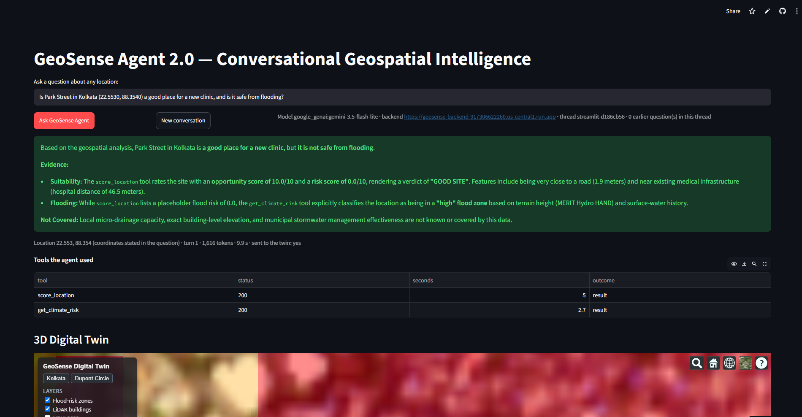
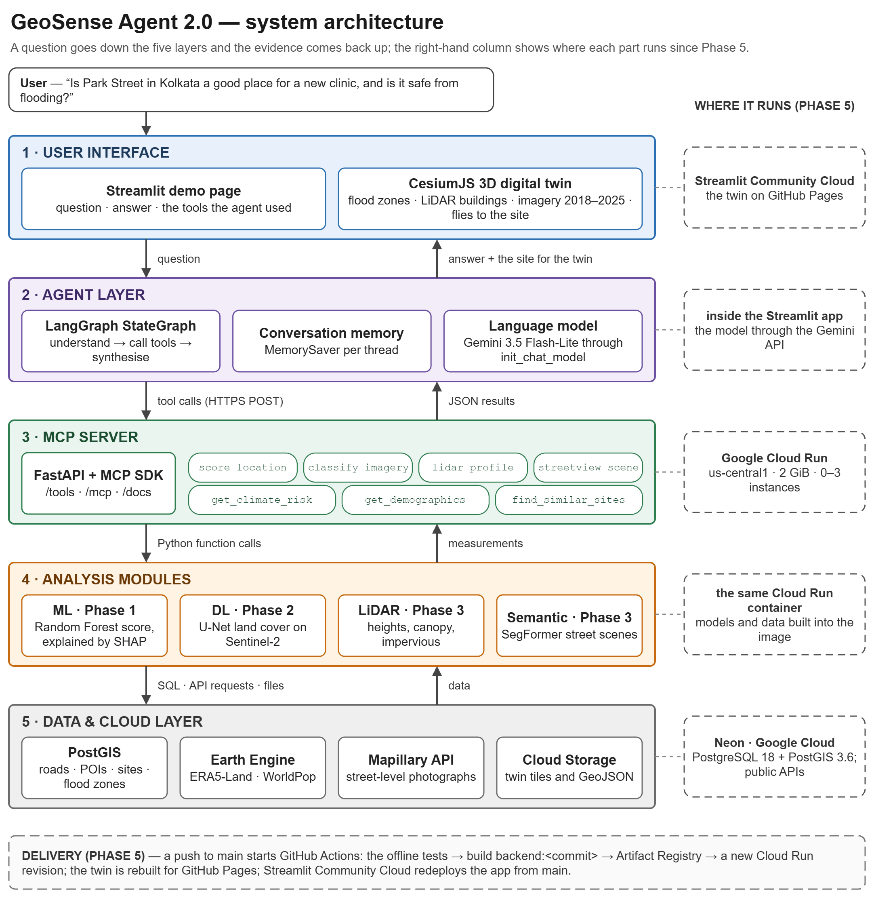
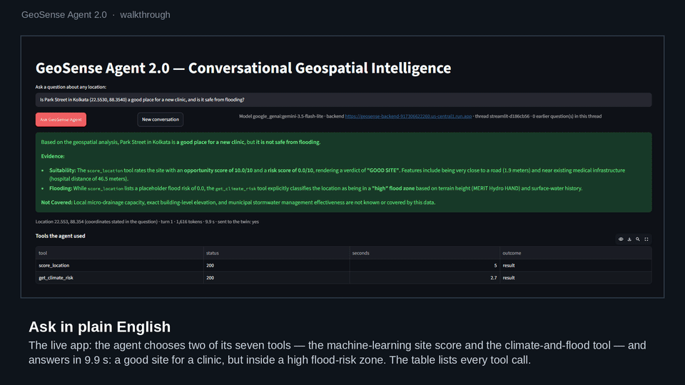
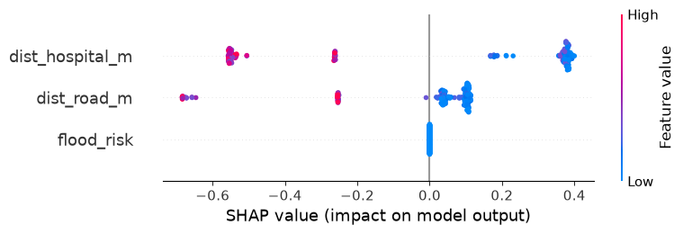
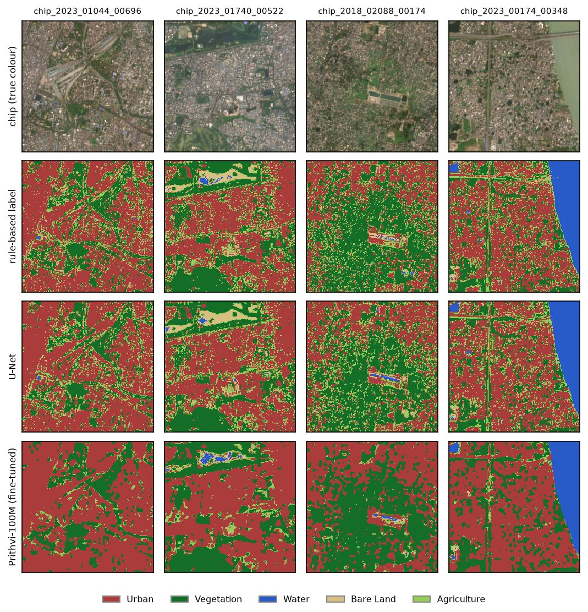
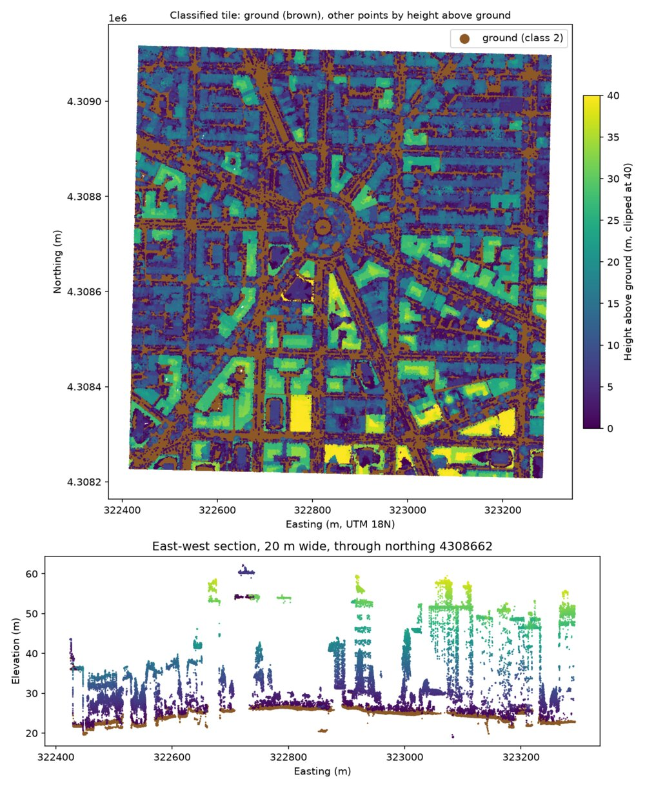
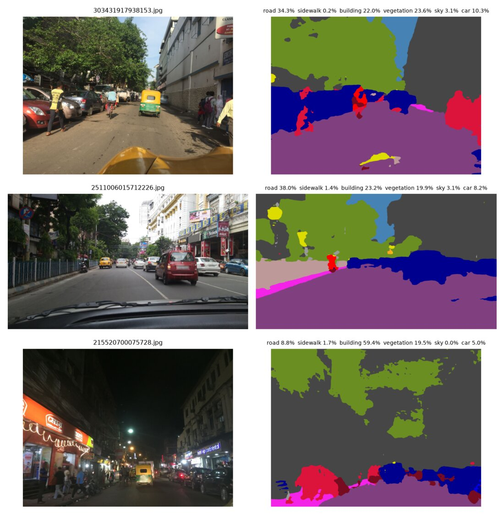
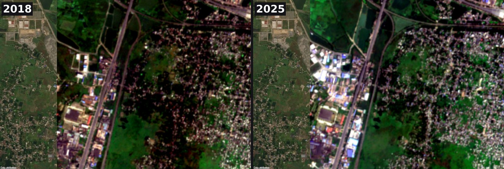

# GeoSense Agent 2.0

> Conversational Geospatial Intelligence Platform with Digital Twin and LiDAR Semantic Understanding

[](https://github.com/anubhavGIS/geosense-agent-2/actions/workflows/deploy.yml)
[](https://github.com/anubhavGIS/geosense-agent-2/actions/workflows/twin.yml)
[](LICENSE)
[](https://www.python.org/)

**[Live demo](https://geosense-agent.streamlit.app)** | **[3D digital twin](https://anubhavgis.github.io/geosense-agent-2/)** | **[API docs](https://geosense-backend-917306622260.us-central1.run.app/docs)** | **[Demo video](https://youtu.be/Ovwtpb2bGgA)**

Ask a question about a place in plain English — *"Is Park Street in Kolkata a good place for a new
clinic, and is it safe from flooding?"* — and an AI agent decides which analyses answer it, runs
them through an MCP tool server (machine learning on spatial features, deep learning on Sentinel-2
imagery, LiDAR, street-level photographs, climate and population data), writes an answer that cites
its evidence and flies a 3D digital twin of the city to the site.



*The first question after a quiet spell can take about a minute: the backend scales to zero and
starts on demand.*

## The problem

Governments, hospitals, businesses and city planners ask location questions every day: where to
build a clinic in a flood-prone city, which neighbourhoods combine heat stress with poor access to
health care, what the land at a site is covered with, how tall and how green a district is.
Answering them still takes GIS specialists, licensed software and separate tools for satellite
imagery, LiDAR, flood and population data that do not talk to each other — and there is no way to
simply ask. GeoSense Agent 2.0 puts these analyses behind one conversational interface: a question
goes in, and an evidence-based answer and a 3D view of the site come out.

## Architecture



A question goes down five layers and the evidence comes back up. The Streamlit page and the LangGraph
agent run on Streamlit Community Cloud; the agent calls the seven tools of the MCP server on Google
Cloud Run, whose container also holds the analysis modules, the trained models and the data files;
PostGIS runs on Neon, climate and population come from Google Earth Engine, and the CesiumJS twin is
served by GitHub Pages with its imagery tiles in Cloud Storage. The diagram's source is
[docs/portfolio/architecture_diagram.drawio](docs/portfolio/architecture_diagram.drawio) (draw.io).

## Tech stack

| Area | Tools |
|---|---|
| Core and spatial data | Python 3.11, GeoPandas, rasterio, PostgreSQL + PostGIS, Google Earth Engine |
| Machine learning | scikit-learn (Random Forest), XGBoost, SHAP |
| Deep learning | PyTorch, segmentation-models-pytorch (U-Net), NASA–IBM Prithvi-EO-1.0-100M (Hugging Face) |
| LiDAR and imagery | PDAL, laspy, Open3D, Segment Anything (SAM), SegFormer, Mapillary API |
| Agent | MCP Python SDK, FastAPI, LangGraph, LangChain `init_chat_model`, Gemini API (Claude is a one-line switch) |
| Digital twin and front end | CesiumJS with Cesium ion World Terrain, Vite, Streamlit |
| Deployment | Docker, Docker Compose, Google Cloud Run, Artifact Registry, Secret Manager, Cloud Storage, Neon, GitHub Actions, GitHub Pages, Streamlit Community Cloud |

## Features

- **Natural-language site scoring (ML)** — a Random Forest on road distance, hospital distance and
  flood risk from PostGIS scores any point of the study area from 0 to 10 and explains the score
  with SHAP.
- **Satellite land-cover classification (deep learning + Prithvi)** — a U-Net trained on Sentinel-2
  chips maps urban land, vegetation, water, bare land and agriculture, with NDVI, NDWI and the
  change since 2018; NASA–IBM's Prithvi-100M foundation model was fine-tuned on the same chips and
  compared.
- **3D LiDAR analysis** — building height, tree canopy, impervious surface and slope for any box of a
  USGS 3DEP point cloud (6.4 million points, ground and height above ground from PDAL).
- **Street-level walkability (SegFormer)** — Mapillary photographs segmented into road, sidewalk,
  buildings, vegetation, sky and cars, summarised as a walkability score from 0 to 10.
- **MCP-based AI agent (LangGraph)** — the analyses are seven MCP tools; the agent picks the ones a
  question needs, remembers the conversation, and says what the data does not cover.
- **Interactive 3D digital twin (CesiumJS)** — flood-risk zones, 2,898 extruded LiDAR building cells,
  Sentinel-2 imagery of 2018, 2021, 2023 and 2025 on a time slider, an NDVI layer, and a camera that
  flies to every site the agent discusses.
- **Cloud deployment with CI/CD** — containers on Cloud Run, PostGIS on Neon, the twin on GitHub
  Pages; every push of code runs the tests and, when they pass, deploys a new revision.

## Results

| Part | Measured on | Result |
|---|---|---|
| Site scorer (Phase 1) | 225 held-out candidate points (rule-derived labels) | Random Forest accuracy 1.000; SHAP: hospital distance first, road distance second |
| Land cover (Phase 2) | 32 held-out Sentinel-2 chips, 1.59 million labelled pixels | U-Net 87.2 % pixel accuracy, mean IoU 66.6 %; fine-tuned Prithvi-100M 76.1 %, 44.7 % |
| LiDAR (Phase 3) | Dupont Circle tile, Washington, D.C. (0.8 km², 6.28 million classified points) | mean building height 18.2 m, tree canopy 23.9 %, impervious surface 43.2 % |
| Agent (Phase 4) | 6 test questions, three prompt styles | the right tools for 6 of 6 questions when the tools are described (1 of 6 with a vague prompt) |
| Cloud API (Phase 5) | 20 sequential site-score requests to Cloud Run | 0 errors, average 3.44 s, 95th percentile 4.52 s; a cold start takes about 71 s |

## Demo and screenshots

[](https://youtu.be/Ovwtpb2bGgA)

*The three-minute walkthrough video: [youtu.be/Ovwtpb2bGgA](https://youtu.be/Ovwtpb2bGgA).*

| | |
|---|---|
|  |  |
|  |  |
|  |  |

Captions: [docs/portfolio/screenshots/README.md](docs/portfolio/screenshots/README.md).

## Running locally

The whole stack — PostGIS with the project's tables, the FastAPI + MCP backend and the Streamlit
app — starts with one command from the project root:

```bash
docker compose --env-file .env -f deploy/docker-compose.yml up --build
```

Then: tool server and API docs at http://localhost:8000/docs, Streamlit at http://localhost:8501,
PostGIS at localhost:5433. The twin runs with `cd frontend/digital_twin && npm install && npm run dev`
(http://localhost:5173). The data, the trained models and the database dump are not committed
(several gigabytes); the scripts of each phase regenerate them, and `deploy/export_db.py` writes the
dump that the database container restores. The `.env` keys and the per-phase commands are in
[docs/project_phases.md](docs/project_phases.md).

## API documentation

Once running, visit **/docs** on the backend URL for interactive API documentation — live:
https://geosense-backend-917306622260.us-central1.run.app/docs. Each tool is `POST /tools/<name>`
with a JSON body, and the same seven tools are published on the MCP endpoint `/mcp` (streamable
HTTP) for any MCP client:

```bash
curl -X POST https://geosense-backend-917306622260.us-central1.run.app/tools/score_location \
     -H "Content-Type: application/json" -d '{"latitude": 22.5530, "longitude": 88.3540}'
```

| Tool | What it returns | Where it answers |
|---|---|---|
| `score_location` | opportunity and risk score (0–10), SHAP explanation, GOOD / POOR SITE | Kolkata study area |
| `classify_imagery` | land cover, confidence, NDVI, NDWI, change 2018 → 2023 | Kolkata study area |
| `lidar_profile` | building height, canopy, impervious surface, slope risk for a box | the Dupont Circle LiDAR tile |
| `streetview_scene` | scene composition and walkability (0–10) | wherever Mapillary has photographs |
| `get_climate_risk` | ERA5-Land temperature and rainfall anomaly, drought index, flood-risk zone | worldwide; flood zone in the study area |
| `get_demographics` | people within 1 km (WorldPop), nearest hospital, hospitals within 2 km | worldwide; hospitals in the study area |
| `find_similar_sites` | ranked candidate sites with a similar suitability profile | Kolkata study area |

A point outside a tool's coverage gets `available: false` and a reason instead of an invented number.

## Deployment and CI/CD

| Part | Where | Updated by |
|---|---|---|
| Backend (FastAPI + MCP, modules, models) | Google Cloud Run `geosense-backend`, us-central1 (2 GiB, 0–3 instances) | `deploy.yml` on every push that changes `src/`, `tests/` or the image recipe: 13 offline tests → `backend:<commit>` built on the released image → Artifact Registry → a new revision → `/health` |
| Database | Neon (PostgreSQL 18 + PostGIS 3.6) | `deploy/restore_cloud_db.py` |
| Digital twin | GitHub Pages; imagery tiles and GeoJSON in Cloud Storage | `twin.yml` on every push that changes the twin |
| Streamlit app with the agent | Streamlit Community Cloud | redeploys itself from `main` |

Secrets live in Secret Manager, GitHub secrets and Streamlit's secrets — never in the repository.
Rebuilding everything from nothing, and rolling back a revision:
[docs/redeploy_from_scratch.md](docs/redeploy_from_scratch.md).

## Documentation

- [docs/project_phases.md](docs/project_phases.md) — setup, pipelines, results and commands of
  Phases 1–4 in detail
- [docs/phase5_checklist.md](docs/phase5_checklist.md) and the checklists of Phases 2–4 in
  [docs/](docs/) — what was delivered, with the evidence
- [docs/portfolio/demo_script.md](docs/portfolio/demo_script.md) — the five-minute demo;
  [docs/portfolio/demo_questions.md](docs/portfolio/demo_questions.md) — questions to try
- [docs/postman/](docs/postman/) — the Postman collection of the tool server (23 requests, 71 tests)

## Articles

Three short articles explain the project for a wider audience:

- Part 1 — [Asking a map a question: why conversational geospatial intelligence matters](docs/portfolio/blog/part1_geoai.md)
- Part 2 — [Seven tools, one protocol: plugging geospatial analysis into an AI agent with MCP](docs/portfolio/blog/part2_mcp.md)
- Part 3 — [A digital twin of Kolkata in the browser with CesiumJS](docs/portfolio/blog/part3_digital_twin.md)

## Licence and data

Code: [MIT licence](LICENSE), © 2026 Anubhav Ghosh. The data and models used keep their own
licences: OpenStreetMap data © OpenStreetMap contributors (ODbL); Sentinel-2 imagery © ESA/Copernicus
via Google Earth Engine; Prithvi-EO-1.0-100M © IBM/NASA (Hugging Face,
`ibm-nasa-geospatial/Prithvi-EO-1.0-100M`); USGS 3DEP LiDAR and USDA NAIP imagery are U.S.
public-domain data; Mapillary photographs © their contributors (CC BY-SA 4.0); Segment Anything © Meta
Platforms (Apache 2.0); SegFormer weights © NVIDIA (`nvidia/segformer-b0-finetuned-cityscapes-1024-1024`);
MERIT Hydro © Yamazaki et al. (CC BY-NC 4.0 / ODbL) and JRC Global Surface Water © European Commission
JRC / Google via Earth Engine; ERA5-Land contains modified Copernicus Climate Change Service
information; WorldPop (CC BY 4.0); geocoding by OpenStreetMap Nominatim (ODbL); CesiumJS © Cesium GS
(Apache 2.0) with Cesium World Terrain and Bing imagery through Cesium ion.

---

*Anubhav Ghosh · M.Tech Geoinformatics, Department of Geography, University of Madras*
