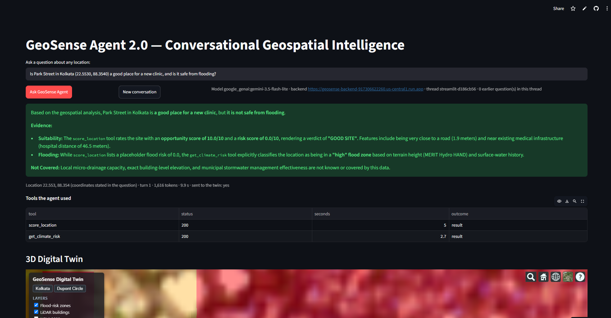
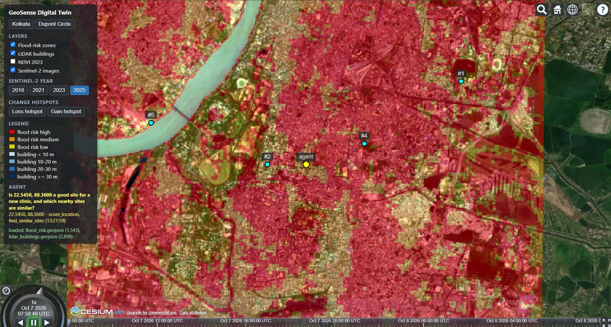

# Asking a map a question: why conversational geospatial intelligence matters

*GeoSense Agent 2.0, part 1 of 3 — GeoAI concepts*

Some of the most important questions a city asks are questions about places. Where should a new
clinic go in a city that floods every monsoon? Which neighbourhoods combine heat stress with poor
access to a hospital? What is the land at a proposed site actually covered with, and how tall and
how green is the district around it?

Answering any one of these today usually means a GIS specialist, licensed desktop software, and a
week of moving data between separate tools — one for satellite imagery, one for elevation, one for
flood maps, one for census or population grids. None of them talk to each other, and none of them
lets a planner simply ask.

That gap is what my M.Tech project, **GeoSense Agent 2.0**, set out to close: a platform where you
type a question in plain English and get an answer backed by real spatial analysis, shown on a 3D
model of the city.

## Why it matters now

Location intelligence is no longer a niche. Fortune Business Insights estimates the global
geospatial analytics market at about USD 117 billion in 2026, growing by almost 13 % a year to
2034. Health care, insurance, energy, agriculture, logistics and public administration all depend on
it — yet much of the work is still manual.

Two things changed recently. Machine learning and deep learning made it possible to read imagery,
point clouds and street photographs automatically. And language models made it possible to put a
conversation in front of all of it, so that the hard part — deciding which analysis answers which
question — can be delegated to an agent.

## What "GeoAI" means in this project

I think of the system as a team of specialists with a coordinator. Each specialist was built and
tested on its own, one phase at a time, over Kolkata:

1. **A machine-learning site scorer.** A Random Forest scores any point of the study area from 0 to
   10 using its distance to the nearest road and hospital (OpenStreetMap data in PostGIS) and its
   flood risk, and SHAP explains each score.
2. **A deep-learning image analyst.** A U-Net trained on Sentinel-2 imagery classifies land cover —
   urban, vegetation, water, bare land, agriculture — and measures NDVI and the change since 2018.
   I also fine-tuned NASA and IBM's Prithvi-100M foundation model on the same chips.
3. **A LiDAR analyst** that turns a 6.4-million-point USGS 3DEP point cloud into building heights,
   tree canopy and impervious surface, and **a street-level analyst** that segments Mapillary
   photographs with SegFormer to judge how walkable a street is.
4. **The coordinator:** an AI agent that exposes all of these — plus climate, population and
   similar-site tools — through the Model Context Protocol, and a CesiumJS digital twin that shows
   the result in 3D.
5. **Deployment:** everything runs in the cloud, and every change to the code is tested and deployed
   automatically.

## One question, end to end

Here is a real exchange with the deployed system. I asked: *"Is Park Street in Kolkata a good place
for a new clinic, and is it safe from flooding?"*

The agent chose two of its seven tools: the site scorer and the climate-and-flood tool. Its answer:
Park Street is a **good site** — the nearest road is 1.9 m away and the nearest hospital 47 m, which
gives an opportunity score of 10 out of 10 — but it is **not safe from flooding**: it lies in a
high flood-risk zone. Rainfall over the past year was 6.7 % above the 1991–2020 normal, and the
temperature close to normal. It ended by saying what the data does not cover: economic viability,
zoning law and subsurface soil.

The whole answer took under ten seconds. More importantly, every number in it came from a tool, and
the interface lists each tool call with its status and time, so the reasoning can be checked.

## Three lessons from building it

**Data decides more than the model.** The flood layer that made the Park Street answer possible
came from the height of every 30 m cell above its nearest drainage line. Two-thirds of the study
area's land is in the high-risk class, and half of it lies within 1.3 m of a drainage line — a fact
about Kolkata that no model could have invented.

**Bigger is not automatically better.** On my labels the U-Net trained from scratch reached 87.2 %
pixel accuracy, the fine-tuned Prithvi foundation model 76.1 %. The labels are per-pixel spectral
rules at 10 m, which the U-Net's skip connections reproduce almost exactly, while the foundation
model summarises each 16 × 16-pixel patch. Foundation models shine with scarce labels and new
regions; here the simpler model fitted the task.

**Honesty is a feature.** A tool asked about a point outside its coverage answers "not available"
with a reason instead of inventing a number, and the agent passes that on. For a decision-support
system, knowing what it does not know matters as much as what it does.

## Try it

The system is live and the code is open:

- Live demo: https://geosense-agent.streamlit.app
- 3D digital twin: https://anubhavgis.github.io/geosense-agent-2/
- Code: https://github.com/anubhavGIS/geosense-agent-2
- Three-minute walkthrough video: https://youtu.be/Ovwtpb2bGgA

In part 2 I explain how the seven analyses became tools that an AI agent can call, using the Model
Context Protocol.

---

Part 2: [Seven tools, one protocol: plugging geospatial analysis into an AI agent with MCP](part2_mcp.md) →
