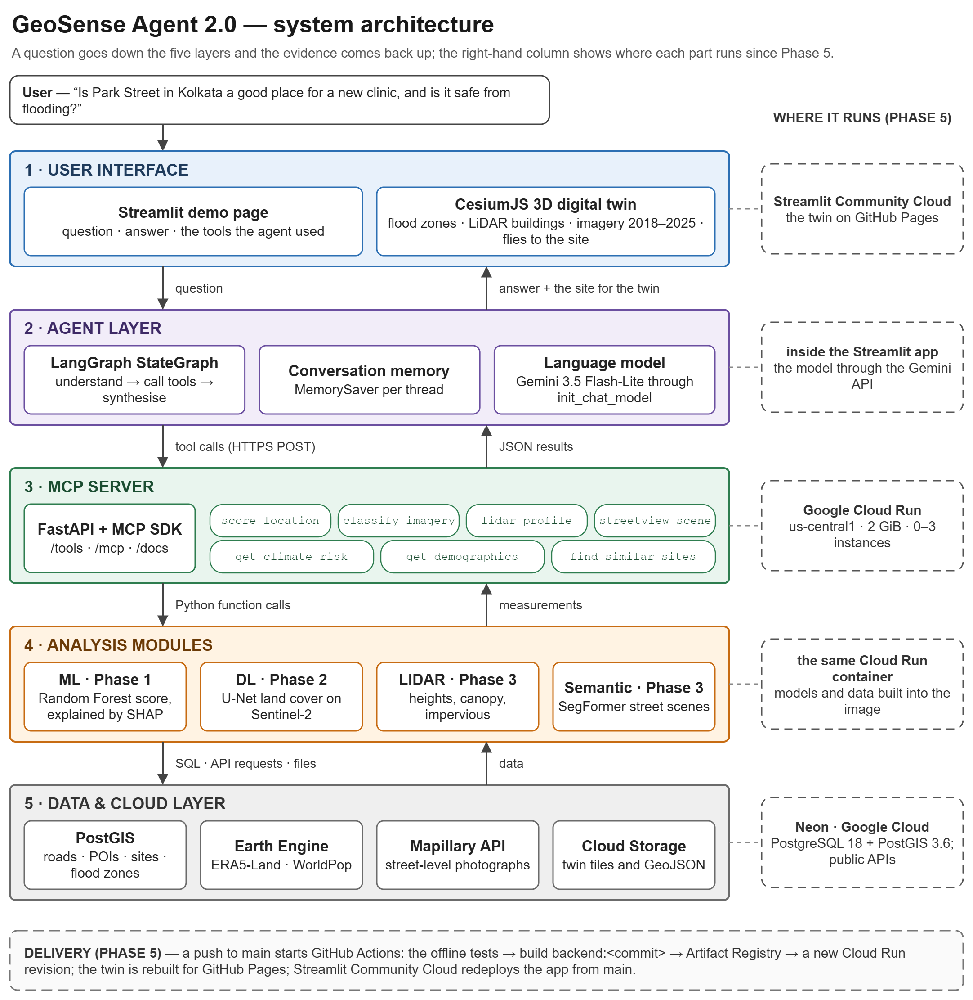

# Seven tools, one protocol: plugging geospatial analysis into an AI agent with MCP

*GeoSense Agent 2.0, part 2 of 3 — MCP integration*



In part 1 I described GeoSense Agent 2.0 as a team of specialists — a machine-learning site scorer,
a deep-learning image analyst, a LiDAR analyst, a street-level analyst — with a coordinator that
decides whom to ask. This part is about the coordinator, and about the protocol that lets it talk to
the specialists: the **Model Context Protocol (MCP)**.

## What MCP is

MCP is an open protocol, introduced by Anthropic in late 2024, for connecting AI applications to
tools and data. A server publishes a list of tools; each tool has a name, a description written for
a model, and a JSON Schema for its input. A client — an AI assistant, an IDE, or an agent of your
own — discovers the tools at run time and calls them with structured arguments. Messages are
JSON-RPC; a server can be reached as a local process or over HTTP.

Why does that matter for agentic AI? Without a protocol, every model and every tool needs custom
glue code. With one, the analysis lives in one server, and any MCP-capable client can use it. My
agent is one such client; a desktop AI assistant pointed at the same endpoint would see the same
seven tools.

## The seven tools

- `score_location` — the Random Forest site score with SHAP (Phase 1), for the Kolkata study area
- `classify_imagery` — U-Net land cover, NDVI and the change since 2018 (Phase 2), study area
- `lidar_profile` — heights, canopy and impervious surface from LiDAR (Phase 3), the LiDAR tile
- `streetview_scene` — SegFormer on Mapillary photographs (Phase 3), wherever photographs exist
- `get_climate_risk` — ERA5-Land anomalies, a drought index and the flood zone, worldwide
- `get_demographics` — WorldPop population and the nearest hospitals, worldwide
- `find_similar_sites` — the 1,125 scored candidate sites in PostGIS, study area

The server is a FastAPI application with the MCP Python SDK mounted on it. Every tool exists twice —
as a REST route (`POST /tools/score_location`, with interactive documentation at `/docs`) and as an
MCP tool at `/mcp` — and the MCP version simply answers through the REST route, so both interfaces
validate and compute in exactly the same way:

```python
@mcp.tool(name='score_location', description=about(tool_score_location),
          annotations=READ_ONLY)
def mcp_score_location(latitude: Lat, longitude: Lon) -> JSON:
    return mcp_call(tool_score_location, LocationInput,
                    latitude=latitude, longitude=longitude)
```

Two design rules made the tools safe for an agent. First, a point outside a tool's coverage
returns `available: false` and a reason rather than a made-up number. Second, failures are
distinguishable: an invalid request is HTTP 422, an unreachable data source 503.

## The agent

The agent is a LangGraph `StateGraph` with three nodes:

1. **understand_query** — the language model reads the question and the tool descriptions and
   returns JSON: which tools to call, plus any coordinates or place name it finds.
2. **execute_tools** — the graph calls the chosen tools over HTTPS, with a timeout, and records a
   failure as a note instead of crashing.
3. **synthesize_response** — the model writes the answer from the tool results only, with numbers,
   units and the tool each comes from, and says what is not covered.

The model is a setting: LangChain's `init_chat_model("google_genai:gemini-3.5-flash-lite")` runs it on
the free tier of the Gemini API, and switching to Claude is a one-line change. A `MemorySaver` keeps
each conversation's state, so a follow-up such as *"What about its walkability?"* reuses the place
of the previous question.

## Tool descriptions are prompts

The most useful experiment of the project was the cheapest. I asked six test questions with three
ways of presenting the tools to the model: a vague instruction, a bare list of tool names, and the
names with one-line descriptions of what each tool measures and where it works. The vague prompt
chose the right tools for 1 question of 6, the bare list for 5, the described tools for all 6. The
descriptions cost more tokens — about 2,700 for the six questions instead of about 600 — and are
worth every one.

## From laptop to cloud

The server now runs on Google Cloud Run, and two deployment details are worth sharing.

The MCP SDK protects its HTTP endpoint against DNS rebinding by checking the `Host` header. On the
laptop that is invisible; on Cloud Run the first MCP request was refused with HTTP 421 until the
service's public host names were added to the allowed list.

Concurrency needs a decision, not a default. The analyses share large models in memory, so the
server runs one at a time. Twenty requests in sequence averaged 3.4 s each with no errors; ten sent
at once queued behind one another and the last waited about 28 s. For a demo that is acceptable; for
production the fix is more instances with one request each, or analyses that share their models
safely.

## Try it

The REST interface is documented at
https://geosense-backend-917306622260.us-central1.run.app/docs, the agent is in the live demo at
https://geosense-agent.streamlit.app, and the code is at https://github.com/anubhavGIS/geosense-agent-2.
Part 3 is about the 3D digital twin that shows each answer on a globe.

---

← Part 1: [Asking a map a question: why conversational geospatial intelligence matters](part1_geoai.md)  
Part 3: [A digital twin of Kolkata in the browser with CesiumJS](part3_digital_twin.md) →
