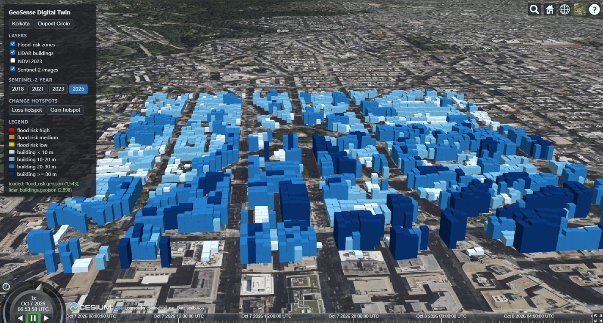
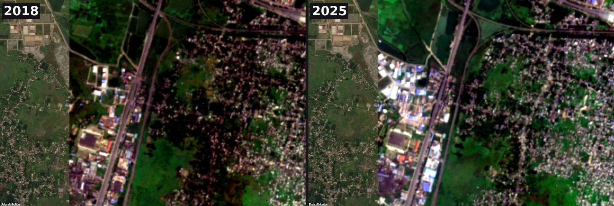
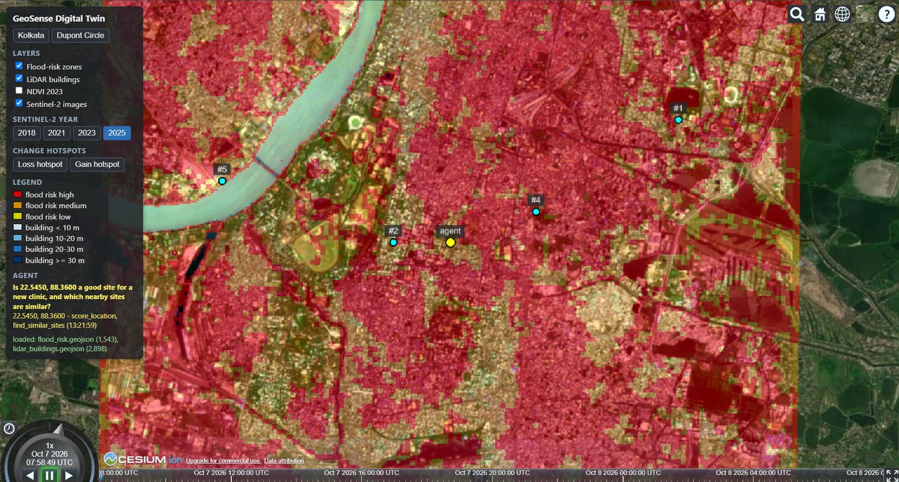

# A digital twin of Kolkata in the browser with CesiumJS

*GeoSense Agent 2.0, part 3 of 3 — the 3D digital twin*



An answer about a place is easier to trust when you can see the place. The last part of GeoSense
Agent 2.0 is a 3D digital twin: a model of the study area on a globe, with the project's own data
drawn in position, that flies to every site the AI agent talks about. It runs in any browser at
https://anubhavgis.github.io/geosense-agent-2/.

## CesiumJS and Cesium ion

**CesiumJS** is an open-source JavaScript library (Apache 2.0) that renders a WGS 84 globe with
WebGL: terrain, imagery layers, vector data, 3D models and a camera you can script. **Cesium ion**
is the companion cloud service that streams the heavy base data — Cesium World Terrain and global
aerial imagery — to CesiumJS with an access token. The community tier is enough for a portfolio
project. Because the token reaches the browser, the public build uses one that can only read assets
and is restricted to the site's own address.

The twin itself is a small Vite project. One detail for anyone following older tutorials: in
CesiumJS 1.146, `createWorldTerrain()` no longer exists; terrain is passed to the viewer as
`Cesium.Terrain.fromWorldTerrain()`.

## The layers

Everything on the globe comes out of the earlier phases of the project:

- **Flood-risk zones.** Each 30 m cell's height above its nearest drainage line (MERIT Hydro) and
  the surface-water history (JRC Global Surface Water) were classified as high, medium or low risk
  in Earth Engine, dissolved into polygons in PostGIS and exported as GeoJSON. In the twin they are
  clamped to the terrain in red, orange and yellow.
- **LiDAR buildings.** From the classified Washington, D.C. point cloud, every 10 m cell that is at
  least half building points became a footprint with its measured height — 2,898 of them, from 2.9
  to 51.3 m — extruded and shaded by height class. Clicking one opens its height.
- **Sentinel-2 imagery of four years** — 2018, 2021, 2023 and 2025 — cut into 1,995 web-map tiles
  from zoom 10 to 15, plus an NDVI layer of 2023.

The year buttons act as the time slider, and one decision makes them honest: all four years are
stretched with the same colour limits, measured on 2023. A change of colour between years is then a
change on the ground, not a change of contrast. At the vegetation-loss hotspot that the
deep-learning phase found north-west of the city, moving from 2018 to 2025 shows green land turning
into new roofs — the change that the classifier measured as a fall of NDVI from 0.50 to 0.30 by 2023
continuing two more years.



## Fly-to: connecting the agent to the twin

The agent and the twin never talk directly. After every answer the agent posts the place it
discussed — coordinates, the question, the tools used and any similar sites — to an endpoint of the
tool server. The twin asks that endpoint for the latest result every three seconds and moves only
when the result is new (simplified from the twin's `main.js`):

```javascript
async function pollAgentResult() {
  const response = await fetch(`${SERVER_URL}/agent/latest_result`);
  const result = await response.json();
  if (result.id === undefined || result.id === lastResultId) return;  // nothing new
  lastResultId = result.id;
  showAgentResult(result);
  flyToResult(result);
}
setInterval(pollAgentResult, 3000);
```

`flyToResult` places a yellow marker on the agent's site and cyan, ranked markers on the similar
sites, then flies the camera to 800 m above the site — or higher, four times the distance of the
farthest similar site, so that every marker is in view.



## Lessons

**Geocoders are not coordinate parsers.** Typing "88.3022, 22.6462" into the viewer's search box
flew the camera to the Vosges in France: the geocoder looked up "88", the number of that French
département. The twin now has buttons for its places and a small `flyToDegrees(lon, lat)` function.

**Keep the site small and the data elsewhere.** The published site is about 35 kB of HTML, CSS and
JavaScript plus CesiumJS's own assets. The 217 MiB of tiles and both GeoJSON layers are in a
public Cloud Storage bucket with CORS enabled for the site's origin, and GitHub Actions rebuilds and
publishes the twin whenever its code changes.

**Polling is enough.** A WebSocket would be more elegant, but a three-second poll that compares one
id is simple, survives restarts of either side, and costs one tiny request.

## Wrapping up the series

GeoSense Agent 2.0 started as five separate exercises — a site scorer, an image classifier, a LiDAR
and street-level pipeline, an agent and a twin — and ends as one system you can talk to. The live
demo, a three-minute walkthrough video and the code are open:

- Live demo: https://geosense-agent.streamlit.app
- Digital twin: https://anubhavgis.github.io/geosense-agent-2/
- Code: https://github.com/anubhavGIS/geosense-agent-2
- Demo video: https://youtu.be/Ovwtpb2bGgA

---

← Part 2: [Seven tools, one protocol: plugging geospatial analysis into an AI agent with MCP](part2_mcp.md)
